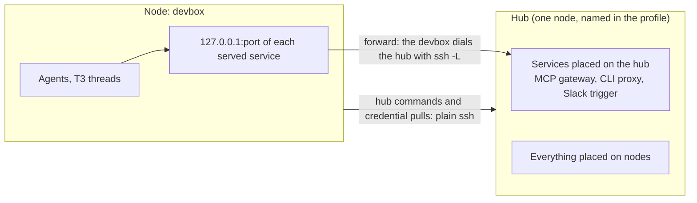

# Fleet v2 architecture

Status: proposal. Nobody has approved it yet. Each decision has a number
(D1, D2, ...) and a reason, so a reviewer can accept or reject it alone.

## In short

- **Model.** Every machine is a node. The profile names one node as the hub.
- **Extension unit.** A pack: one `pack.ts` plus standard agent content.
- **Placement.** An item runs `on: "hub"` or on every node. A node reaches a
  hub service at the same loopback port, through an SSH forward.
- **SDK.** `register(fleet)` declares items, and handlers get `ctx`. A pack
  imports types only, and `pack.json` keeps loading.
- **T3 interface.** Packs name capabilities: `ctx.threads`, `fleet.task`,
  `fleet.projectScript`. One engine module holds T3's session and RPC code.
- **First slice.** The Slack pack runs from a `pack.ts` on a freshly
  created machine that is its own hub: setup, event, thread, restart.

## 1. The problem

Fleet serves one person who runs coding agents (Claude Code, Codex) through
T3 Code on a Mac and on several Linux devboxes, and who wants every machine
to behave the same. A pack ships agent content (skills, hooks, MCP entries)
and machine work (services, timers, sign-ins, tunnels). No plugin can do
the machine work, and it has no interface to code against:

- **No SDK.** Packs import `../../base/lib/command.ts`, `settings.ts`, and
  `t3/index.ts` by relative path. A pack in another repo cannot, so one
  private team pack copies those helpers.
- **Placement is not a concept.** An item names machine roles
  (`Scope.roles`, `src/pack/types.ts:53`). "Runs on the hub, and every other
  machine uses it" is built by hand for each service: its own unit, key
  flow, and port in `tunnelUnit` (`packs/hub/lib/tunnels.ts:29`). Pack code
  checks the role itself in about 30 places.
- **The Hub pack is a grab bag** of 12 commands and 6 workflows: a box
  pool, an MCP gateway, HTTPS, SSH tunnels, T3 links, a CLI proxy, a disk
  watch, and Dream.
- **T3 is known in many places.** The engine and the Base pack each hold a
  T3 session client, and pack code sends raw RPC tags.
- **The engine knows one private pack** by name (`resolve.ts:210-211`,
  `Audience` in `src/pack/types.ts:4`), and its seam list is closed
  (`handlerSeams`, `src/pack/types.ts:133`).

The private Fleet that runs the real machines has guards and monitors that
the engine lacks. That port is separate work and is not in this document.

## 2. Domain model

### 2.1 Hub and nodes



- **D1. Every machine is a node, and the hub is one of them.** A node is a
  machine that `fleet apply` ran on. The hub is the one node that also runs
  everything placed on the hub. An item on `nodes` runs on every node, the
  hub included.
  *Reason:* today most hub items say `roles: ["hub", "devbox"]`. One rule,
  "the hub is a node", removes that list from a ported pack.
- **D2. The profile names the hub.** `fleet.json` gets one field,
  `hub: "<node name>"`. `fleet hub here`, an engine command since step 2
  (section 8.3), writes it, and `fleet hub status` shows it. The nodes that
  the profile names are the hub plus today's `devboxes`. The machine file
  stores the machine's own name, its SSH name, once: `fleet apply` saves
  the host name when none is saved, and `fleet hub here <ssh name>` saves
  another one. A machine is the hub when `profile.hub` is its name, and
  `resolve` derives its schema 1 role `hub` from that. While a schema 1
  pack loads, the machine file keeps `role` (D22): `fleet hub here` saves
  `role: "hub"`, `profile.hub` wins when the two disagree, and apply saves
  the derived role.
  *Until the profile names a hub,* `on: "hub"` keeps today's predicate: the
  saved role is `hub`, or the machine is solo (`resolve.ts:63`). A profile
  that lists devboxes makes no machine solo, so a machine without the
  saved role drops its hub items, with a note that names
  `fleet hub here`. A profile that names a hub makes no machine solo. So such a profile never gets several Slack triggers.
  *Reasons:* "You can define where the hub runs" becomes one line that
  every node reads from the same profile. Today the role sits in each
  machine file and the hub's name in the `hub.alias` setting, so they can
  disagree. A node list with `os` would be a second copy of `devboxes`.
- **D22. Placement is additive. A schema 1 pack keeps today's role
  predicate.** `on`, `os`, and the node facts apply only to items of a
  `pack.ts`. `resolve` keeps `roles`, `solo`, and `Workflow.needs` as they
  are for every `pack.json`, and the machine file keeps `role` while one
  schema 1 pack loads. Each port states its behavior change (section 7).
  In a `pack.ts`, `needs: hub` goes, because every fleet has a hub, and
  `always-on devbox` becomes the scope `{ on: "hub", os: "linux" }`.
  *Reasons:* a `roles` list is a union and the `Scope` fields are a
  conjunction, so no global translation keeps behavior: `["hub", "devbox"]`
  in `packs/hub/pack.json` has no single v2 scope. Pack code reads the role
  directly (`packs/hub/lib/machine.ts:71-85`).
- **Node facts for a `pack.ts`.** `MachineRole` mixes three questions. A
  `pack.ts` asks them apart: `os`, `isHub`, and `name`.

### 2.2 The unit of extension

- **D3. The unit stays a pack. Fleet does not add "package",** the word of
  the vision. An **item** is one thing that a pack declares.
  *Reasons:* the unit is still what a person turns on. The word is already
  in the CLI (`fleet packs`), the profile, the page, and the changelog. In a
  Bun repository "package" already means an npm package.
- **D4. A pack has a `pack.ts` and agent content, each in one format.**
  `pack.ts` declares everything, with scopes. Agent content stays in
  standard formats: Agent Skills, hook scripts, MCP server entries. The
  directory also holds `lib/` for the pack's code and tests, and
  `instructions.md`, the always-loaded fragment that a plugin cannot ship.
  A pack source stays a Git repo at a pinned ref.
- **D5. A pack is as small as one capability with one placement story.**
  The Hub pack splits (section 7). The hub becomes an engine concept, not a
  pack.

### 2.3 Proposed `GLOSSARY.md` changes

| Word | Definition | Note |
| --- | --- | --- |
| **Pack** | An opt-in unit that adds one capability: a `pack.ts` plus agent content. | Add "package" to _Avoid_, and remove "plugin" from it. |
| **Plugin** (new) | A standard Claude Code plugin that Fleet builds on a machine from one pack source's own skills. | _Avoid_: using it for a pack. No pack author writes one. |
| **Node** (new) | A machine that Fleet is applied to. | _Avoid_: spoke. |
| **Hub** | The one node that runs everything placed on the hub. The profile names it. A single machine is its own hub. | |
| **Placement** (new) | Where an item runs: on the hub or on every node. | |
| **Service** (new) | A pack's process that runs all the time. systemd, launchd, or the supervisor that it already has keeps it running. | Replaces "a job with `every: always`". |
| **Forward** (new) | A loopback port on a node that reaches the same port on the hub. | |
| **Check** (new) | A test with an optional repair, by Fleet or by a person. | Replaces human step, step, and check. |
| **Seam** (new) | A named, typed interface that one pack declares and another pack provides. | Replaces handler. |

## 3. What Fleet hands off

- **D6. The rule: when a plugin, systemd or launchd, or T3 can do a thing,
  Fleet declares it there and does not run it.**

| Need | Owner | Fleet's part |
| --- | --- | --- |
| A pack source's own skills, in Claude Code | Plugin | Build one plugin per pack source and install it (D23, step 6). Today's path until then. |
| Other skills, and every skill in Codex | Fleet | Today's path, unchanged: linked Agent Skills. |
| Always-loaded instructions and guides | Fleet | Unchanged. A plugin's `CLAUDE.md` is not loaded. |
| Hook entries, MCP entries, `env`, `apiKeyHelper`, permissions, model, T3 settings | Fleet | Provider config keys, with the one-owner rule of today. |
| A process that runs all the time, a timer | systemd, launchd, cron, or the supervisor that it already has | Render one unit from one `service` or `job`. Fleet restarts and supervises nothing itself. |
| Agent threads, scheduled agent prompts, worktree scripts | T3 | Declare them (section 6). Fleet has no thread scheduler. |
| Sign-ins, repairs, `fleet doctor`, placement, forwards, the credential pull | Fleet | Checks, and the new parts of v2. Only Fleet knows the nodes. |

- **D7. The engine runs no daemon.** The engine is a CLI and a reconciler.
  Every long-running process is a pack's service. The operating system
  keeps it alive, or the supervisor that it already has (section 4.2).
- **D8. The hook dispatcher stays, and so do its config entries.**
  `packs/base/hooks/run.ts` runs every hook file in name order and gives
  one answer: a block wins, and the first redaction is kept, so no other
  hook can undo the secret guard. Plugin hooks run in parallel and
  guarantee neither. The `hooks.<Event>` entries that start the dispatcher
  stay provider config of the Base pack (`packs/base/pack.json:271-307`).
  A pack's hook stays a file that the dispatcher runs.
- **D9. Skills ship in two standard ways, and no third.** A pack's own skill
  joins its source's plugin. A skill from another source is linked as an
  Agent Skill, as today: 34 of the 37 skill references in the engine's
  packs name another source.
- **D23. One plugin per pack source, built on the machine, for Claude Code
  only, with skills only.** A pack lists its own skills with `fleet.agent`,
  an item with a scope. `fleet apply` builds one plugin directory for each
  pack source from the skills that the plan keeps, lists the plugins in one
  local marketplace file, adds that marketplace, and installs them. The
  plugin's version is a hash of its built content, and apply refreshes the
  installed plugin when the hash changes. Hook entries and MCP entries stay
  provider config, as today (D8, `mcpServers.fleet-hub`). Codex keeps
  today's path.
  *Reasons:* a plugin is on or off as a whole, so a workflow or `os` scope
  must apply before the plugin exists. A config entry already has a scope
  and one owner, so a gated MCP entry stays gated with no new code. The
  plan shapes the plugin, so a content hash says when it changed, and the
  source's commit does not.
  *Size:* the gain is small: the packs own about 3 skills.
  `reconcilePlugins` installs known ids only (`plugins.ts:36-49`), so
  build, add, refresh, and removal are new code. So this is step 6, the
  last step, and it is optional: when the one-skill trial fails (risk 2),
  D23 leaves v1.
- **Secrets stay in Fleet.** A service on a headless hub has no agent
  session, so plugin `userConfig` cannot reach it. It reads `ctx.secrets`,
  a private file store for each pack.
- **State files.** `~/.local/state/fleet/state.json` stays the installer's
  ownership record (`src/files/install.ts:10`). No hook reads a setting
  today, so v1 adds no file. The first hook that needs one gets the
  resolved settings in `~/.local/state/fleet/settings.json`, read-only.

## 4. Placement

### 4.1 Declaring where an item runs

Every item of a `pack.ts` takes the same `Scope` (section 5.2). No field
means every node, the hub included. `on: "hub"` places an item on the hub,
`os` names an operating system (schema 1 `on: Os[]` loads as `os`), `when`
names a workflow, and `after` names a check. `on` means placement and
nothing else. Where an interface names one node, the field is `node`.

- **D10. Placement has two values.** There is no "nodes except the hub" and
  no list of node names. A handler that must differ reads `ctx.node.isHub`.
  *Reason:* the two values cover every item in today's packs once forwards
  belong to the engine. A third value can come when a pack needs it.
- **`after` is a readiness gate, tested once.** `fleet apply` tests every
  gate before the adapters run, drops the items whose gate failed from the
  plan, with the reason, and runs the adapters once. The adapters do not
  change (D18): their pruning stops and removes a unit that left the plan
  (`src/adapters/jobs/adapter.ts`, `provider-config/adapter.ts:133-149`).
  No v1 gate tests what the same apply installs: the Slack gate reads a
  secret, and `route` reads the network. Today's lazy `waiter` stays for
  steps only. A gate test is local: it runs no command on another node.
  When a pack command exits 0 and its words equal a check's
  `repair.command`, the engine applies in the same process. A service whose
  gate fails while its unit is still installed waits: `fleet run` prints the
  To do once and tests the gate every minute, until it passes or the next
  apply removes the unit.

### 4.2 How a node uses a service on the hub

A service that other nodes use declares `serve`:

```ts
fleet.service({ on: "hub", id: "gateway", serve: { port: 3317, health: "/health", credential: grant } });
```

This service names no process. Docker already restarts the gateway's
container (`--restart unless-stopped`, `packs/mcp-gateway/lib/install.ts`),
and Fleet does not wrap it in a unit.

- **The service catalog comes from declarations (D11).** Every node
  resolves the same profile and pack sources, so every node computes the
  same catalog: `<pack>/<service id>` to port. `resolve` builds it before
  it filters items for the local machine (`resolve.ts:64-73`), or a node's
  plan would miss the hub service that it needs. The catalog judges `plans`
  and `when` on the profile. It judges `os` on this machine when this
  machine is the hub, and as `linux` on any other node, because v1's one
  topology has a Linux hub (D13). It does not judge `after`, which only the
  hub knows. Nobody sends the catalog, and no daemon discovers services.
  Two packs that claim one port fail at resolve time.
- **Addressing: loopback, the same port everywhere (D12).** A served
  service answers at `http://127.0.0.1:<port>` on every node. On the hub
  that is the service itself. On another node it is a forward.
- **A forward carries ports and nothing else (D13).** Three drivers exist
  today: the hub dials a devbox with `ssh -R` (`tunnels.ts:29`), the hub
  dials a box with `coder ssh -R` (`links.ts:108`), and a Mac dials the hub
  with `coder port-forward` (`hub-tunnel.ts:21`). v1 supports one topology
  in full: a Linux hub and Linux devboxes. **The node dials the hub with
  `ssh -L`** (Michael, 2026-11-10). Each node that the profile names, other
  than the hub, gets one engine-owned service, `hub-forward`, rendered from
  its own catalog at its own apply. The Jobs adapter renders and prunes it
  like any service, and a catalog change rewrites and restarts it. The hub
  renders no forward and needs no SSH access to nodes. Its sshd must allow
  local forwarding to the catalog ports, which the hub's bring-up sets.
  `tunnelUnit` keeps the relay port, the proxy port, and the devbox hosts
  entry (`tunnels.ts:29,93-103`) until their packs move in step 4: the
  proxy port then joins the catalog, and the rest goes with `peers`. It no
  longer carries the gateway port to a devbox that the profile names. A
  devbox that only the hub's machine file names (`fleet devbox add`) keeps
  the gateway port in its hub tunnel until the profile names it and names
  a hub. In the switch, the node's forward retries until the hub's tunnel
  lets go of the port, so the gateway is back once both have applied. A box gets
  no `hub-forward`, even when the profile names it, because its box forward
  carries the hub's ports. The other two drivers stay in today's code.
  *Reason:* a forward is not a command channel, and one topology that works
  end to end is worth more than three that share an abstraction. A node
  already dials the hub for commands and credentials, so the forward needs
  no second direction.
- **Commands and credentials travel over plain `ssh`, from the node to the
  hub.** A node runs a hub command as `ssh <hub> fleet <command>`, as
  `toHub` does. During its own apply a node pulls each credential the same
  way: `ssh <hub> fleet credential <pack>/<id> <node>`, at every apply, so a
  new key on the hub reaches the node. The hub answers only for a node that
  the profile names. Every such call goes through one engine path
  (`src/hub/ssh.ts`): `BatchMode`, a checked host name, each word quoted,
  and Fleet's launcher at its install path, not the login `PATH`. The hub
  runs no command on a node, so `fleet mcphub grant` and its accept command
  are gone. A machine without plain `ssh` to the hub is outside v1's
  topology.
- **Each service issues its own credentials (D14).** The engine mints no
  key. A service that needs one declares `serve.credential(ctx, node)`,
  which returns the value for that node. The hub calls it when a node
  asks, and directly for itself. The node stores the answer in the pack's
  secret store, and `ctx.use` returns it. When the hub does not answer,
  the node keeps its stored credential, and apply reports a finding. The
  finding names the exit code and the command that shows why, and copies
  nothing that the hub printed, in case the service prints its key. When
  the hub's own issue fails, its finding copies nothing that the service
  threw, and names `fleet credential <pack>/<id> <hub>` to see why.
  *Reason:* the MCP gateway already mints a scoped key for each machine
  (`grant`, `packs/mcp-gateway/lib/hub.ts`), and the CLI proxy has
  one shared key in its config. Engine keys would be a second auth system.
- **A node works without the hub (D15).** `ctx.use` fails fast, but that
  protects only pack code. An agent reads a static `ANTHROPIC_BASE_URL`.
  So the route is a gated config item:
  - *Owner:* provider config owns the two keys, like every config key. The
    pack owns only the probe, a check. The config items say `after: route`.
  - *Apply while the proxy does not answer:* the gate fails, the two items
    leave the plan, and the adapter removes its own values. Claude Code
    uses its own sign-in. A key that holds exactly the pack's value also
    goes when no apply recorded it, as after `fleet cli-proxy connect`,
    and while a pack source cannot be fetched. The items that wait for
    one check go together, so they all stay when one holds another value.
  - *Until recovery:* each `fleet apply` and `fleet doctor` reports the
    failed check. The first apply whose probe passes writes both keys
    again. Between applies nothing changes the route.
  *Reason:* today the adapter writes the keys and then a step removes them
  (`route`, `packs/hub/lib/cli-proxy.ts:198-204`): two writers of one key.

| Consumer on a node | How it reaches the service |
| --- | --- |
| Pack code | `const { url, credential } = await ctx.use(service)` |
| Provider config | `value: service.url` and `service.credentialCommand`, fixed strings at resolve time |
| An agent | A `config` MCP entry starts a pack command that calls `ctx.use` |

### 4.3 Worked examples

**The CLI itself.** `fleet` is on every node. A command carries a placement:

```ts
fleet.command("box", { on: "hub", summary: "Borrow, run on, and return boxes", run });
```

On the hub the engine runs it. On a node that the profile names the engine
runs `ssh <hub> fleet box ...` with this terminal and returns the hub's exit
code. Any other machine is told to run it on the hub. Resolve collects every command
before it filters items for the local machine, as `packCommands` does today
(`resolve.ts:360`), so every node knows the name. `on` only selects where
the command runs. Pack code no longer calls `requireHub` or builds
`remoteFleet` strings. SSH is the remote call, so the CLI needs no API.

**The CLI proxy** (pack `cli-proxy`, step 4).

```ts
const hub = { on: "hub", when: balancing } as const;
const node = { os: "linux", when: balancing, plans: ["claude", "both"] } as const;
const proxy = fleet.service({ ...hub, id: "proxy", command: proxyCommand, serve: { port: 8317, credential: sharedKey } });
fleet.job({ ...hub, id: "balance", every: "5m", run: balance });
const route = fleet.check({ ...node, id: "route", say: "Claude Code cannot reach your proxy, so it uses its own sign-in.", test: reachable });
fleet.config({ ...node, after: route, provider: "claude", key: "env.ANTHROPIC_BASE_URL", value: proxy.url });
fleet.config({ ...node, after: route, provider: "claude", key: "apiKeyHelper", value: proxy.credentialCommand });
```

The proxy is a third-party binary, so it is a `command` and gets no Bun
parent process. The pack writes no unit and no tunnel line.

**The MCP gateway** (pack `mcp-gateway`, step 2). The pack declares the
served service of section 4.2, one check whose repair Fleet runs (today's
install step), the client check, and the `config` MCP entries that start
`fleet mcp-connect`, the stdio bridge of today, which calls `ctx.use`.
`fleet mcp-gateway` is the hub's administration: doctor, sign-in,
reconnect, and restart. Its sign-in prints each upstream authorization URL
directly, not a page that only Caddy serves, and tells the person to run
`coder port-forward <hub> --tcp 3317` on the Mac. So the browser reaches
the gateway at loopback without private HTTPS. Apply tests the checks that
served services wait for first and issues their credentials, so the client
check's repair writes today's client file from the new key in the same
apply. A node pulls its key from the hub at every apply, and the client
check's repair moves a key from today's client file into the store once.
`fleet mcp-gateway` runs on the hub, also when you type it on a node. A profile that lists the Hub pack gets this
pack too, until it turns the `mcp-gateway` workflow off.

**The Slack trigger** (pack `slack`, section 5.3) serves nothing: it opens
a socket to Slack. Placement on the hub means that one runs. **An API** (a
future pack) is one hub service with `serve` that answers HTTP. Access from
outside the fleet is that pack's concern.

## 5. The SDK

### 5.1 The primitive

A pack is one `pack.ts` with one default export. The file imports **types
only**. Everything a pack can do arrives as an argument: `fleet` at
registration time, `ctx` at run time.

- **D16. Registration by a function, not by JSON.** `register` must be
  pure: it declares and returns.
  *Reasons:* handles give typed links (`ctx.get(setting)`, `when: workflow`,
  `value: service.url`) where `pack.json` has strings that fail at run
  time. A test passes a fake `fleet` and a fake `ctx`, so no test needs a
  home directory.
- **D17. No runtime import from the engine.** `import type` is erased, so
  a pack source needs no install step and cannot run against another SDK
  than the engine that loads it. A pack in another repo adds the engine as
  a development dependency, for the types and the test fakes. Packs inside
  the engine repo keep their relative imports of `../base/lib`.
- **D18. `pack.json` keeps loading.** A schema 1 manifest and a `pack.ts`
  both produce the same `Plan`. The adapters do not change, and `apply`
  gains the readiness gate. Packs move one at a time.

### 5.2 Type signatures

The first slice ships only what the Slack pack uses:

```ts
/** Where and when an item applies. No field means every node. Os, AiPlan, and Value are today's types. */
export type Scope = { on?: "hub"; os?: Os; plans?: AiPlan[]; when?: Workflow; after?: Check };
export type Pack = {
  sdk: 1; name: string; summary: string; title?: string; day?: string; cost?: string; risk?: string;
  requires?: string[]; register(fleet: Fleet): void;
};
export type Fleet = {
  setting<T extends Value>(def: SettingDef<T>): Setting<T>;
  workflow(def: WorkflowDef): Workflow;
  command(name: string, def: { summary: string; run(args: string[], ctx: Context): Promise<number> }): void;
  service(def: Scope & { id: string } & Process): Service;
  check(def: Scope & { id: string; say: string; test(ctx: Context): Promise<boolean>; repair?: Repair }): Check;
};
/** The body in Bun that the service's unit runs as fleet run <pack>/<id>. */
export type Process = { run(ctx: Context): Promise<void> };
export type Repair = { ask: string; command?: string; interactive?: true };
export type Context = {
  get<T extends Value>(setting: Setting<T>): T;
  secrets: { read(name: string): Promise<string | undefined>; write(name: string, value: string): Promise<void> };
  stateDir: string; print(line: string): void; log(line: string): void;
  now(): number; sleep(ms: number): Promise<void>; threads: Threads;
};
/** key is the caller's idempotency key. A second start with the same key returns the same thread. */
export type Threads = { start(def: { key: string; title: string; prompt: string; modelRole: string }): Promise<{ id: string; url?: string }> };
```

Later steps add the rest. Each line names its step in section 8.3:

```ts
export type FleetLater = {
  config(def: Scope & { provider: "claude" | "codex" | "t3"; key: string; value: unknown }): void;                 // 2
  job(def: Scope & { id: string; every: "5m" | "15m" | "1h" | "1d"; at?: string } & Process): void;                // 4
  file(def: Scope & { target: string; source: string }): void;                                                     // 4
  instructions(def: { always?: string; guides?: Array<{ guide: string; path: string; section?: string }> }): void; // 4
  task(def: Scope & Task): void; projectScript(def: Scope & ProjectScript): void;                                  // 4
  seam<T>(id: string): Seam<T>;                                                                                    // 5
  provide<T>(seam: Seam<T>, def: Scope & { load(ctx: Context): T | Promise<T> }): void;                            // 5
  agent(def: Scope & { skills: string[] }): void;                                                                  // 6
};
/** Step 2: service takes serve?: Serve and can omit its process, and Repair takes { run(ctx) }. Step 3: command takes on?: "hub".
    Step 4: Process takes { command: string[] }, the unit's own process, as PackJob.command is today, for cli-proxy.
    Scope takes on?: "nodes" when a pack first needs it. In steps 1 to 3 all three Serve fields are required,
    and Service stays an opaque handle: its url and credentialCommand come with cli-proxy in step 4. */
export type Serve = { port: number; health: string; credential(ctx: Context, node: string): Promise<string> };
export type Service = { id: string; url: string; credentialCommand: string };                                     // url, credentialCommand: 4
export type ContextLater = {
  node: { name: string; os: Os; isHub: boolean };                                                                  // its first user
  use(service: Service): Promise<{ url: string; credential: string }>;                                             // 2
  run(argv: string[], options?: { input?: string; timeoutMs?: number }): Promise<{ code: number; stdout: string; stderr: string }>; // 4
  seam<T>(seam: Seam<T>): Promise<T | undefined>;                                                                  // 5
};
```

`Setting`, `Workflow`, `Check`, and `Seam` are opaque handles. `SettingDef`
and `WorkflowDef` keep the fields of today's `PackSetting` and `Workflow`,
and a workflow's `settings` holds handles. `Task` and `ProjectScript` keep
the fields of today's T3 job and `T3ProjectScript`, with a `Setting` handle
for a project. In step 4, `Pack` takes today's `models` table.

- **D24. A seam is a typed handle.** `fleet.seam<T>(id)` returns the handle,
  and `provide` takes the handle, not a string, so `load` must return the
  seam's type. The pack whose name starts the id owns the seam and exports
  its type. A pack in another repo imports that type and calls `fleet.seam`
  with the same id. Resolve fails when no owner names a provided seam, or
  when two packs provide one seam on one node. There is no `many`.
  *Reason:* today's seam is a string from a closed list in the engine.

Today's item kinds keep their names where a name exists above. The others
map like this: a pack's own `skills` become `agent`, and MCP and hook
entries stay `config` (D23). A job with `every: "always"` becomes a
`service`, and a job with `runner: "t3"` a `task`. `human`, `steps`, and
`checks` become `check`, with a repair by a person, by Fleet, or none.
`handlers` become `seam` and `provide`.

### 5.3 One complete pack

```ts
import type { Pack } from "fleet/sdk";

export default {
  sdk: 1, name: "slack", title: "Slack",
  summary: "Your own message, reaction, or mention in Slack starts a T3 thread about it.",
  risk: "Your Slack messages become agent prompts. Only your own messages start a thread.",

  register(fleet) {
    const userId = fleet.setting({ key: "slack.userId", type: "string", question: "What is your Slack member ID?" });
    const threads = fleet.workflow({
      id: "slack-thread", name: "Start a thread from Slack", default: false, settings: [userId],
      sentence: "Your own Slack message with :t3code: starts a T3 thread, and Slack shows you its link.",
    });
    const hub = { on: "hub", when: threads } as const;
    const app = fleet.check({
      ...hub, id: "slack-app",
      say: "Make your own Slack app, then paste its two tokens.",
      test: async (ctx) => (await ctx.secrets.read("app")) !== undefined,
      repair: { ask: "Run this command and follow its steps.", command: "fleet slack-trigger setup", interactive: true },
    });
    fleet.command("slack-trigger", {
      summary: "Set up or check your Slack app",
      run: async (args, ctx) => (await import("./lib/command.ts")).slackTrigger(args, await commandDeps(ctx, userId)),
    });
    fleet.service({
      ...hub, after: app, id: "slack-trigger",
      run: async (ctx) => (await import("./lib/command.ts")).listen(await commandDeps(ctx, userId)),
    });
  },
} satisfies Pack;
```

`commandDeps` gives the command and the service the parts of `ctx` that they
use: the member ID through `ctx.get`, the secret store, the state folder,
`threads`, the clock, and `print`. The command and the service keep their
names, so the unit stays
`fleet-slack-trigger.service`. The `key` is the id that the trigger already
stores for each Slack message before it starts a thread
(`packs/slack/lib/trigger.ts:47`). Four points follow from today's code:

- **`ctx.threads.start` replaces only `launchHere`.** When `hub.boxTemplate`
  is set, `launcher` picks `launchOnBox` (`packs/slack/lib/command.ts:42-46`,
  `launch.ts:46-66`). That path stays the pack's own code, unchanged, until
  `boxes` ports in step 4 (section 7). Until then the runner sets the same
  environment as `runPackCommand` does today (`FLEET_SETTINGS`,
  `FLEET_MODELS`, `FLEET_ENGINE_DIR`) for every pack command.
- **The command has no placement in the slice,** because the `launch`
  subcommand runs on a box, and the dispatch of a hub command over `ssh`
  arrives in step 3.
- **`slack.userId` belongs to the workflow** through `settings`, as in
  today's `pack.json`, so resolve asks for it only while the workflow is
  on (`activeSettings`, `resolve.ts:226`).
- **The service restarts when the tokens change.** It watches the secret
  store entry and stops when the entry changes, so the OS starts it again,
  as `waitForTokens` and `watchTokens` do today with the token file.

### 5.4 Who owns what

| The engine owns | A pack owns |
| --- | --- |
| Loading a pack, recording its items, the plan | What it declares, and its handlers |
| Units, timers, logs, restarts through the OS | The process: a command, or a body in Bun |
| Which node runs what, the service catalog, forwards, the credential pull | The port it serves, and issuing and checking its own credentials |
| Running checks, the readiness gate, the words "To do" and "Fix" | The test, the sentence, the repair |
| One owner per config key, port, command name, and seam | Its own names |
| The T3 session code and the RPC tags | The Fleet-shaped request |
| Building and installing the source's plugin | Its skills |

How an item runs: `fleet <command>` resolves the plan as today, loads the
pack that owns the command, and calls `run`. The unit of a service with a
`run` body runs `fleet run <pack>/<id>`. From step 4 of section 8.3, the unit
of a service with a `command` runs that command itself. A person's check loads
as today's human step, with `fleet run <pack>/<id>` as its probe.

## 6. Threads, tasks, and project scripts

- **D19. No session code and no RPC tag lives outside one engine module.**
  The first slice moves `packs/base/lib/t3/` whole into
  `src/integrations/t3/` and leaves `index.ts` as a re-export. Other packs
  keep importing its launcher and read functions until a second user needs
  `threads.read` in `ctx`. Step 4 moves `src/adapters/t3/` there too.
- **D20. Packs speak Fleet's words, not T3's.** A pack names a model
  *role*, a project *path*, and a schedule `{ every, at }`. The module maps
  them to a model selection, a project id, and a trigger.
- **D21. The SDK names capabilities, not T3.** A pack writes `ctx.threads`,
  `fleet.task`, and `fleet.projectScript`. T3 is the only provider, and
  nothing routes between providers. T3's own settings stay
  `config({ provider: "t3" })`, which exists today (`src/pack/types.ts:92`).
  *Reason:* the vision asks for a unified API. A capability name costs
  nothing now, and a pack does not change when a second provider comes. A
  generic interface for providers is a guess until the second one exists.
- **A thread start is idempotent.** `threads.start` takes the caller's
  `key` and passes it to T3 as the launch's command id, as the launcher
  does today (`packs/base/lib/t3/launch.ts:14`). T3 keeps a receipt for
  each command id (`ThreadLaunchService.ts` in T3), so a retry after a lost
  answer returns the same thread. When T3 does not run, `start` rejects
  with a sentence that says so, and the caller keeps its key for the next
  try. Declared tasks and scripts wait with a finding, as today.
- **A script's project comes back.** When a project script names a folder
  by path, Fleet adds the folder back as a T3 project on the next apply,
  and `fleet apply` says which script needs it. To keep it removed, turn
  off the workflow or pack that owns the script.

## 7. Mapping today's packs

A schema 1 pack behaves as today until its port (D22). The last column says
what the port changes. The Hub pack is gone after step 4.

| Today | v2 pack | Items and placement | Behavior change at the port |
| --- | --- | --- | --- |
| Base | `base` | Instructions, model table, the dispatcher and its two hooks, T3 defaults, update and prune jobs: nodes. Disk watch: hub. | None |
| Pull requests | `pull-requests` | Guides, settings, `fleet pr`, `fleet proof`: nodes. Owns the seam `pull-requests/review-bot`. | None |
| Orchestration | `orchestration` | Commands: nodes. Three T3 tasks: hub. | Each task runs once, on the hub. Today it is planned on the hub and on every devbox. |
| Communication | `communication` | Instructions and skills: nodes. | None |
| Memory | `memory` | Config, sync job, memory-cap hook: nodes. Dream job and skill: hub. | Dream moves in. Placement was the only reason that it lived in the Hub pack. |
| Hub: MCP gateway | `mcp-gateway` | Served service under Docker's restart policy, install check with a Fleet repair: hub. Client check, MCP config entries with the bridge: nodes. | Each node pulls its key during apply. `fleet mcphub grant` by hand goes. The sign-in command prints the authorization URL, not a page that Caddy serves. |
| Hub: own-account balancing | `cli-proxy` | Service with `serve`, balance job: hub. Route check, two gated config keys: Linux nodes. | A Linux node that is not a devbox also gets the route. The route step goes (D15). |
| Hub: boxes | `boxes` | `fleet box`, sweep and nightly jobs, a token check: hub. Restore job: `os: "linux"`. | `fleet box` on a node runs on the hub over `ssh`. A plain Linux node also gets the restore job. A Mac never does. |
| Hub: SSH tunnels to devboxes | The engine's forwards, and `peers` | Step 3: each devbox dials the hub with one engine `ssh -L` unit that carries the catalog's ports. `tunnelUnit` keeps the rest (D13). | A devbox has its own forward to the hub, and the hub's `ssh -R` unit no longer carries the gateway port. |
| Hub: T3 links between nodes, the box forward, the Mac's hub tunnel, private HTTPS | `peers`, schema 1 | `peers.ts`, `links.ts`, `hub-tunnel.ts`, `https.ts`, unchanged in v1 | None |
| Slack | `slack` | Section 5.3. Check and service: hub. Command: no placement. | The service waits for the tokens. `ctx.threads.start` replaces only `launchHere`. With `hub.boxTemplate` set, the pack's own `launchOnBox` still launches on a box, unchanged until `boxes` ports in step 4, and the `launch` subcommand still runs on that box. |
| The private team pack | Stays private | Setup checks, a T3 project script, gated MCP entries, a file, a provider for `pull-requests/review-bot` | Its own port, in step 5 |

**The split keeps three contracts** until their consumers move:

- The extracted `linked-hub` workflow says `needs: hub`, which holds only
  while a pack named `hub` is on (`resolve.ts:209`). When the Hub pack
  goes, that line also accepts `peers`.
- `links.ts:43-69` hands `~/.config/fleet/mcphub.client.json` and
  `cli-proxy.key` to a box. The `mcp-gateway` and `cli-proxy` ports keep
  both files at today's paths until `links.ts` reads the secret store.
- The box restore job keeps a scope that excludes the Mac (the table).

**The engine stops knowing the private pack** in step 5. `Audience`, the
two needs that only it satisfies (`resolve.ts:210-211`), and
`ownDevboxPacks` (`src/setup/defaults.ts:5`) go. The pack states `requires`,
declares checks, and provides seams. `fleet.command`, `ctx.run`, and
`ctx.get` replace the three helpers that it copies today.

## 8. The first slice, the cutover, and later steps

### 8.1 The first slice

**Step 1 is one vertical slice:** a machine that is its own hub runs the
Slack pack from a `pack.ts`, beside the JSON packs. It is a stack of five
PRs that merges as one unit, and it holds everything that it uses:

1. **`ctx.threads.start` with a key.** `packs/base/lib/t3/` moves whole
   into `src/integrations/t3/` and leaves a re-export (D19).
2. **SDK types and the loader.** `src/sdk/` with the slice's types. Load
   `pack.ts`, run `register` against a recorder, and emit today's
   `LoadedPack`.
3. **Runner, context, and secret store.** `fleet <command>` and
   `fleet run <pack>/<id>` call handlers with a real `Context`.
4. **Readiness gate.** `apply` gets the readiness gate.
5. **The Slack port.** `pack.json` goes. The tokens live in the secret
   store only. No machine runs the engine's Slack pack yet, so no token
   file moves.

The slice reads no `profile.hub`: the dog-food hub is solo in step 1, so
`on: "hub"` keeps today's predicate. All of D2 lands in step 2, where
`fleet hub here` writes the field.

**Proof, through the CLI only.** One outside-in test uses a temporary home,
a fake Slack, and a fake T3. The same four steps then run by hand on the
dog-food hub, with its own Slack app (section 8.2):

1. *Setup.* `fleet apply` with the workflow on and no tokens writes no unit
   and lists the To do. `fleet slack-trigger setup` stores the tokens and
   exits 0, so the engine applies and starts the unit. A second apply
   keeps the service running. An apply without the tokens removes it.
2. *Event.* The owner's Slack message causes exactly one thread start.
3. *Thread.* Slack shows the thread's link.
4. *Restart.* T3's first answer is lost and the service restarts. It sends
   the same key, gets the same thread, and posts one link.

Before the test exists, one duplicate launch runs against a real T3, to
confirm that the second answer names the first thread. The fake T3 then
deduplicates by command id in the same way, so the restart proof does not
test a fake that ignores the key.

**What a person gains:** only the setup: today the service starts before
the tokens exist. The rest is the base for step 2, which follows at once.

### 8.2 Cutover from the private Fleet

The real machines run the private Fleet, not the engine.

- **The dog-food hub** is a freshly created machine: a devbox with its own
  engine profile and no devboxes in it. It is not a box, because a box
  leaves within hours (risk 9). In step 1 it is solo, and the Hub pack is
  not in its profile. Its profile names it as the hub (D2) once step 2
  brings `fleet hub here`.
- **The engine is the only Fleet in that home.** The machine is created
  without the private dotfiles installer, because both Fleets write
  `~/.config/fleet` and name the unit `fleet-slack-trigger.service`.
- **The private Slack trigger stays as it is.** The slice uses a second
  Slack app in a separate developer sandbox workspace, because the same
  workspace would show it the same reactions. The real trigger moves in
  the migration, when the engine starts threads on a guarded coding node.
- **No existing machine moves in these steps.** Step 3's node is a second
  spare devbox. A machine of the private Fleet moves when engine packs
  cover what it uses, guards and monitors included. That parity is separate
  work. The private Fleet ends when no machine runs it.

### 8.3 Later steps

2. **One served hub service, on loopback.** The step holds what it uses:
   `fleet hub here` and the reading of `profile.hub` (D2), `serve`, the service catalog, `ctx.use`,
   `config`, a repair that Fleet runs, and credential issue and storage on
   the hub itself. `ctx.node`, `Service.url`, `credentialCommand`, and the
   optional `serve` fields wait for their first users. The MCP gateway becomes its own pack on the dog-food
   hub, and Docker keeps supervising it. Proof: another node's plan holds
   the gateway in its catalog, the hub's bridge uses a key that the hub
   issued to itself, and one sign-in completes through the Mac's forward.
3. **Forwards, credential pulls, and hub commands for one topology.**
   Each devbox renders its own `ssh -L` forward with the catalog's ports, pull
   credentials with `fleet credential`, and run a hub command from a node.
   A second spare devbox joins as a node.
4. **Finish the split.** `cli-proxy`, `boxes`, `peers`, Dream to Memory,
   disk watch to Base, and the other engine packs. Each port states its
   change and keeps the contracts of section 7. Finish D19. Delete the Hub
   pack.
5. **Open the seams.** `seam` and `provide` replace `handlerSeams`. Remove
   the private names from the engine. The private pack ports itself.
6. **Optional: own skills as one plugin per pack source** (D23), with one
   skill first. When agents no longer find that skill, D23 leaves v1.

**Cut from v1:** keys that the engine mints, `ctx.clients`, `serve.auth`,
`fleet accept`, and any command that the hub runs on a node. A node list in
the profile. A generic integration interface, a second provider, and
`threads.list`, `read`, and `send`. T3 links between nodes in the SDK.
Engine forward drivers for `coder ssh -R` and `coder port-forward`. A
discovery daemon, and any delivery of the service catalog. A timer that
changes the proxy route between applies. A `guards` pack and the private
Fleet's monitors. Plugins for Codex, and hooks or MCP entries in a plugin.
Turning a pack off for one node, an engine API, a second hub, version
ranges between packs, secrets in the keychain, and removing `pack.json`.

## 9. Risks and open questions

Ranked, most important first.

1. **Profile drift between nodes.** Nothing sends the catalog (D11). Two
   nodes at different profile commits compute different catalogs, and a
   stale profile can name an old hub. *Plan, in step 3:* `fleet doctor`
   tests each catalog entry's health path at loopback and names the profile
   commit, so two nodes that show different commits have drifted. The hub
   and its named nodes test the health; a solo machine has no node to
   drift from. The hub skips an entry whose install check is still left,
   because doctor names that check already.
2. **The plugin's skill names.** A skill in a plugin is `source:skill`,
   and instructions, guides, and other skills name skills without a prefix
   today. *Plan:* step 6 moves one skill first. If agents no longer find
   it, D23 leaves v1.
3. **`pack.ts` runs code at resolve time.** `fleet packs` and the page
   builder then run code of packs that are off. A pinned pack source can
   already run code through its commands, but the moment moves earlier.
   *Plan:* `register` gets only the recorder, never a context. Open:
   whether the page needs a generated `pack.json`.
4. **A hub outage between applies.** An agent that is routed through the
   hub fails until the next `fleet apply` (D15). That is today's behavior.
5. **Two formats and two placement rules during the move.** JSON packs
   use roles, and `pack.ts` packs use `on` (D22). *Plan:* port every engine
   pack before v2.0, then keep schema 1 only for packs in other repos.
6. **The forward restarts when the catalog changes.** Turning a served
   pack on or off rewrites the forward and cuts open connections.
7. **Commands run inside the engine's process.** A pack can crash the
   CLI or load slowly. *Plan:* handlers import their code lazily.
8. **Closed: the direction of the forward.** The node dials the hub with
   `ssh -L` (D13, Michael, 2026-11-10). The hub needs no SSH access to
   nodes.
9. **Open: the Mac and boxes as nodes of the engine's forwards.** The hub
   cannot dial a Mac, and a box joins and leaves within hours. Both stay on
   today's code in v1 (D13), so the dog-food hub and its node are devboxes.
10. **The word.** D3 keeps "pack", not "package". Reversing it is cheap
    before the first slice and expensive after it.
